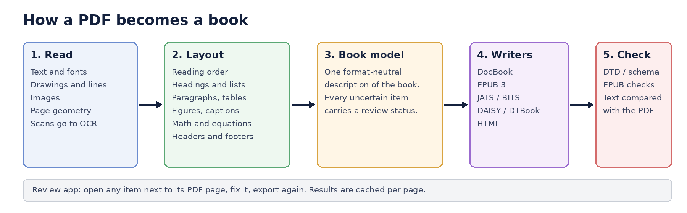

# ebook-converter

A tool that turns PDF books into clean, structured e-book files. You give it a PDF, it works out the structure of each page, and it writes DocBook, EPUB 3, JATS, BITS, DAISY or HTML. A small web app lets a person review the result next to the original page and fix what the machine got wrong.

I built it for a publishing workflow where books arrive as PDFs and have to come out as validated XML or EPUB. This repo holds the code only. The books, client style rules and test data are not included.



## What it does

- Reads text, fonts, drawings, images and page geometry straight from the PDF. Scanned pages go through OCR.
- Works out reading order, headings, lists, paragraphs, tables, figures with captions, math and running headers or footers.
- Keeps everything in one format-neutral book model. Anything it is not sure about is marked for review instead of guessed.
- Writes the output formats from that model. Each client can have a profile (a YAML file) that changes naming, heading levels, reference style and so on.
- Checks the output: DTD and schema validation, EPUB checks, and a comparison of the text against the source PDF so nothing gets lost.
- Caches work page by page, so changing a setting does not mean starting over.

## Review app

A web app on top of the converter. Upload a PDF, pick a profile, run the conversion, then go through flagged items next to the page image. You can edit, split, merge, add or remove text, then export again. It has a job queue, so a few books can run one after another, and it cleans up old preview files by itself.

## Layout

```
backend/src/book_core      PDF reading, layout, structure, tables, figures, math, OCR
backend/src/book_adapters  output formats, writers and validators
backend/src/book_app       review web app, API, job queue
profiles/                  base profiles and the profile schema
upload-page/               a minimal upload page for quick local runs
tools/profile_maker        notes for drafting a client profile
app_settings.yaml          app settings (port, workers, cleanup)
```

## Notes

- Setup details and pinned dependencies are in `backend/pyproject.toml` and `backend/requirements-lock.txt`.
- Tests, sample books and client profiles are left out of this copy on purpose.
- Everything runs on one machine; the PDFs are not sent anywhere.
